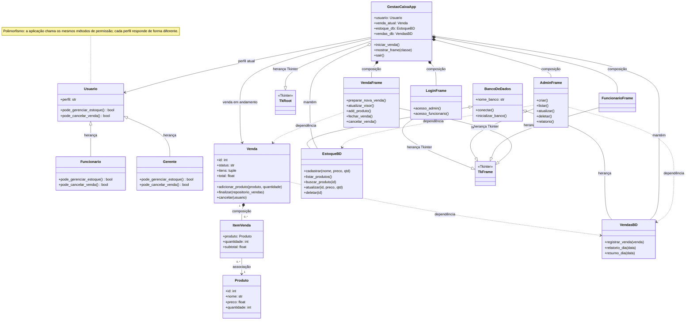

# Diagrama de classes — Sistema Desktop

O diagrama abaixo corresponde às classes da versão atual do código. Ele inclui os modelos de venda, os repositórios SQLite, os perfis e as telas Tkinter.

## Relações representadas

- **Herança:** `Funcionario` e `Gerente` especializam `Usuario`; `EstoqueBD` e `VendasBD` compartilham `BancoDeDados`. As telas também herdam de `tk.Frame`, e a aplicação herda de `tk.Tk`.
- **Polimorfismo:** a aplicação consulta `pode_gerenciar_estoque()` e `pode_cancelar_venda()` no tipo `Usuario`; o resultado muda conforme o objeto concreto (`Funcionario` ou `Gerente`).
- **Composição:** uma `Venda` é formada por seus `ItemVenda`; os itens pertencem à venda em andamento.
- **Associação:** cada `ItemVenda` mantém a referência ao `Produto` correspondente.
- **Dependência:** `Venda` utiliza `VendasBD` para persistir a operação; as telas utilizam os modelos e repositórios para executar as ações solicitadas.

O diagrama não substitui a leitura do código: os métodos e relações podem ser conferidos em `sistema_bd.py` e `gestao_de_caixa.py`.
