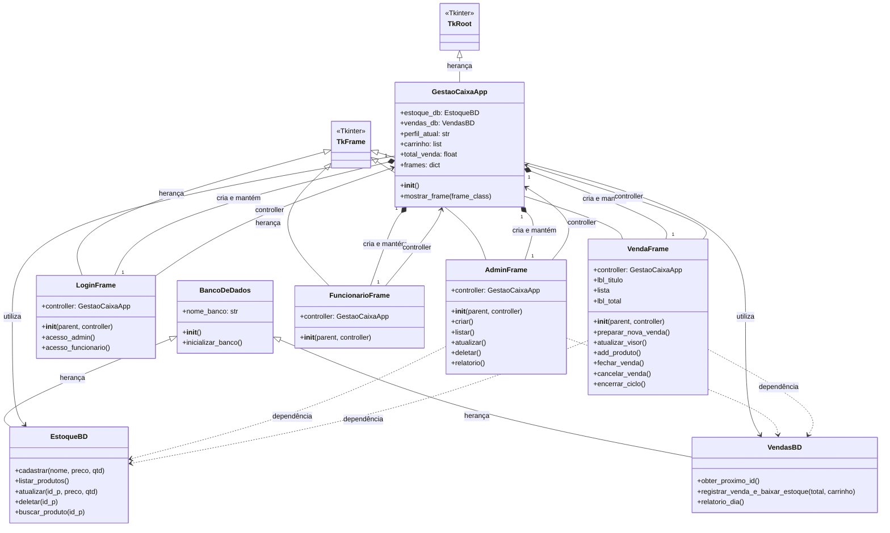

# Diagrama de classes — Gestão de Caixa

## Relações identificadas no código

- **Herança:** `EstoqueBD` e `VendasBD` herdam de `BancoDeDados`. A aplicação herda de `tk.Tk`, e as quatro telas herdam de `tk.Frame`.
- **Composição:** `GestaoCaixaApp` instancia as telas e mantém suas referências no dicionário `frames`.
- **Associação:** cada tela recebe e guarda a referência `controller`, que aponta para a instância de `GestaoCaixaApp`.
- **Dependência:** as telas administrativa e de venda utilizam os repositórios de estoque e vendas por meio do controller.

## Limite importante da modelagem

O código atual demonstra claramente herança, composição/gerenciamento das telas, associação com o controller e dependência dos repositórios. A chamada de `tkraise()` em telas diferentes, por si só, não é uma demonstração forte de polimorfismo definido pela aplicação: é um método herdado do Tkinter. Por isso, não classifico esse ponto como polimorfismo comprovado no modelo.

O estado da venda (`carrinho` e `total_venda`) fica em `GestaoCaixaApp`, e `VendaFrame` executa as operações de inclusão, cálculo e fechamento. Não existe uma classe de domínio `Venda` no código original. O diagrama documenta a implementação atual, não uma refatoração proposta.
